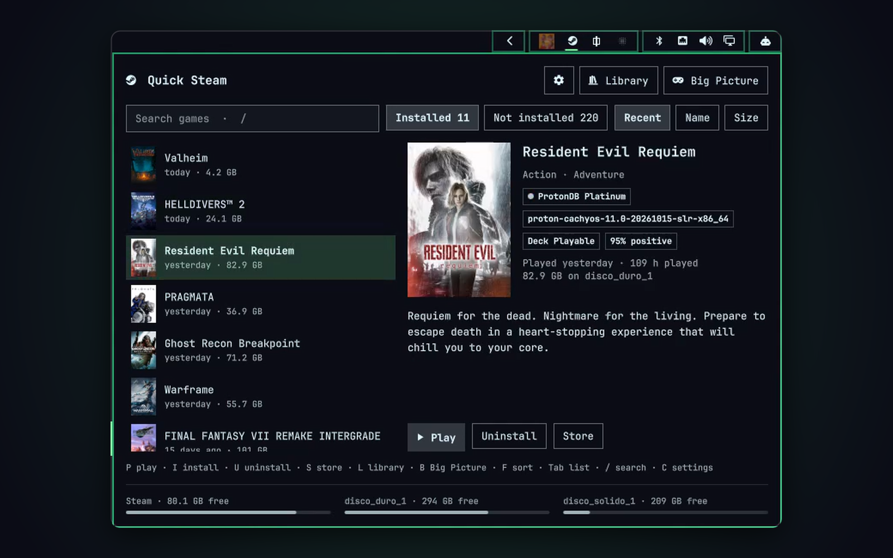

# Quick Steam for Omarchy

Your Steam library one key away, and what Steam is doing right now, in the
Omarchy bar.



The bar shows the Steam icon. While Steam downloads a game, updates one,
fetches Workshop items or pre-compiles shaders, the icon takes your theme's
accent colour and shows the percentage. Open the panel and you get the whole
picture, plus your library with ProtonDB ratings, the Proton version of each
game and the free space left on every Steam library.

## What you get

- **In the bar:** the Steam icon, with a percentage and a thin progress line
  while something is going on. While you play, the game's banner takes the
  icon's place and the tooltip says for how long. Left click opens the panel,
  middle click opens Big Picture, right click opens the Steam library.
- **Activity:**
  - downloads and updates with size, speed and time left;
  - Workshop downloads with how many items are coming;
  - shader pre-caching with its percentage, whether it runs in the
    background or before a game launches, and how many games are queued.
- **Library:**
  - installed and not installed games, read from your Steam licences, so
    games Steam has never downloaded are listed too, while refunded games
    and expired free weekends are left out;
  - games you hid in Steam stay out of the list and the search, as they do
    in Steam's library, unless you turn on "Hidden games" in the settings;
  - search, and sorting by recent, name or size;
  - covers.
- **Details** of the selected game:
  - cover;
  - ProtonDB rating and the Proton version Steam will use;
  - Steam Deck status, review score and genres;
  - playtime and when you last played;
  - the store description.
- **Free space** on every Steam library, at the bottom of the panel.
- **Install and uninstall without Steam's dialogs:** you pick the library
  in the panel, in the free space row, and confirm uninstalls there too.
- **Notifications:**
  - a game installed from the panel started downloading, and where;
  - a game finished installing ("Ready to play") or updating;
  - a game uninstalled from the panel is gone, and how much space it freed;
  - a game's Workshop items finished downloading;
  - Steam finished pre-compiling shaders after more than a minute in the
    background.
- **Keyboard:** everything works without a mouse (see below).
- **Settings page** (the gear, or `C`):
  - language;
  - which sections to show;
  - hidden games;
  - progress in the bar;
  - each kind of notification;
  - and, at the bottom, the plugin's version.
- **Languages:** English and Spanish, following the system language unless
  you pick one.

## Requirements

- Omarchy with shell plugins (tested on 4.0.6).
- Steam, the native package. The Flatpak location is detected too, but it
  hasn't been tested.
- `python3`, which Omarchy already has.

## Install

```sh
omarchy plugin add https://github.com/Rysen-Winters/omarchy-quick-steam.git --enable
```

The icon appears in the right section of the bar. Move it wherever you like:

```sh
omarchy bar move io.github.rysen-winters.quick-steam --section right --index 0
```

To open the panel from the keyboard, add a binding to
`~/.config/hypr/bindings.lua` with any free key:

```lua
o.bind("SUPER + CTRL + G", "Quick Steam", "omarchy-shell shell toggle io.github.rysen-winters.quick-steam")
```

Update or remove it like any other plugin:

```sh
omarchy plugin update io.github.rysen-winters.quick-steam
omarchy plugin remove io.github.rysen-winters.quick-steam
```

## Keyboard shortcuts

Everything in the panel works from the keyboard. Letters are single keys,
with no modifier. Combinations with Ctrl, Alt or Super are left to the rest
of the desktop.

### Opening the panel

Omarchy has no default key for Quick Steam: add one as shown in
[Install](#install). These commands also work in a binding or a script:

| Command | What it does |
|---|---|
| `omarchy-shell shell toggle io.github.rysen-winters.quick-steam` | Open or close the panel |
| `omarchy-shell quick-steam open` | Open the panel |
| `omarchy-shell quick-steam close` | Close the panel |
| `omarchy-shell quick-steam bigPicture` | Open Big Picture |

### In the game list

The panel opens with the list focused. If you are playing, the game you are
playing is selected.

| Key | Action |
|---|---|
| `↑` `↓` | Move through the list. `↑` on the first game goes to the search field |
| `PgUp` `PgDn` | Move 8 games at a time |
| `Home` `End` | Go to the first or last game |
| `Enter` | Press the game's main button: play it, install it, or open Steam's Downloads while it is still downloading |
| `P` | Play |
| `I` | Install (see [Installing and uninstalling](#installing-and-uninstalling)) |
| `U` | Uninstall (see [Installing and uninstalling](#installing-and-uninstalling)) |
| `S` | Open the game's store page |
| `Tab` | Switch between installed and not installed |
| `F` | Change the order: recent, name, or size (size only for installed games) |
| `/` | Go to the search field, with what you typed before selected |
| `L` | Open the Steam library |
| `B` | Open Big Picture |
| `C` | Open the settings |
| `Esc` | Clear the search, then close the panel |

Each letter only works where its button would be. `P` needs a game that is
ready to play, `I` one that is not installed, and `U` one that is.

With the game list turned off in the settings, only `L`, `B`, `C` and `Esc`
are left.

### Installing and uninstalling

`I` asks which library to install to, in the free space row at the bottom
of the panel. With a single library it installs right away. `U` asks you
to confirm. Until you answer, the other keys do nothing.

| Key | Picking a library | Confirming an uninstall |
|---|---|---|
| `←` `→` (or `↑` `↓`) | Choose the library | — |
| `Enter` or `I` | Install to the one marked | — |
| `Y` | — | Uninstall |
| `Esc` or `N` | Cancel | Cancel |

With the mouse, click a library in the free space row, or the "Yes,
uninstall" button. With Flatpak Steam, `I` and `U` open Steam's own
dialogs instead.

### In the search field

| Key | Action |
|---|---|
| Typing | Filters the list. A game has to match every word, and accents are ignored |
| `Enter` | Play or install the selected match |
| `↓` or `Esc` | Go back to the list and keep the filter, so the letters work on the results |
| `Tab` | Switch between installed and not installed |

### On the settings page

| Key | Action |
|---|---|
| `Tab` `Shift+Tab` | Move between the options |
| `Space` or `Enter` | Switch the focused option |
| `←` `→` | Choose a language, then `Space` or `Enter` to apply it |
| `C` or `Esc` | Go back to the panel |

### Mouse

| Where | Action |
|---|---|
| Left click on the bar icon | Open or close the panel |
| Middle click on the bar icon | Open Big Picture |
| Right click on the bar icon | Open the Steam library |
| Double click on a game | Play or install it |
| Click on a download | Open Steam's Downloads |

## Settings

The settings page writes them to the widget's entry in
`~/.config/omarchy/shell.json`, so you can also set them there:

| Key | Default | What it does |
|---|---|---|
| `language` | `"auto"` | `"auto"`, `"en"` or `"es"` |
| `showActivity` | `true` | Downloads, Workshop and shaders in the panel |
| `showLibrary` | `true` | The game list. Activity or the list always stays on |
| `showDetails` | `true` | The details next to the list. Without them the panel is narrower and each row gets its own button |
| `showHidden` | `false` | The games you hid in Steam, in the list and marked Hidden |
| `showProgress` | `true` | Percentage and progress line in the bar |
| `notifyDownloads` | `true` | Notify installs and uninstalls from the panel, and finished installs, updates and Workshop downloads |
| `notifyShaders` | `true` | Notify finished shader pre-caching |

## How it works

Quick Steam only reads Steam's own files and never writes to them. Nothing it
reads leaves your computer:
- `libraryfolders.vdf`: your Steam library folders;
- the app manifests: installed games, their size and download state;
- `appinfo.vdf` and `packageinfo.vdf`, Steam's cache of store data: names,
  genres, Steam Deck status, review scores and the games in each package;
- `userdata/<account>/config/licensecache`: your account's licences, so
  refunded games and expired free weekends stay out of the list. Steam keeps
  this file scrambled, XORed with a pseudo-random stream seeded with your
  account id. Quick Steam unscrambles it in memory and checks its CRC. It
  keeps only each package id and whether its licence is still valid. If
  anything looks off, it falls back to `packageinfo.vdf` alone;
- `loginusers.vdf`: which account logged in last;
- `localconfig.vdf`: playtime and when you last played each game;
- `cloud-storage-namespace-1.json`: your library collections, read only to
  find the Hidden one;
- `config.vdf`: the Proton version of each game and the shader queue;
- `content_log.txt` and `shader_log.txt`: downloads, Workshop items and
  shader pre-caching;
- `registry.vdf` and `/proc`: the game you are playing. In `/proc` it looks
  at process names only, and reads the command line of just two: Steam's
  `reaper`, which runs the game, and `fossilize_replay`, which compiles
  shaders;
- `appcache/librarycache`: the covers Steam has already downloaded.

Besides its settings, Quick Steam writes only its own cache, in
`~/.cache/quick-steam`.

Everything it does in Steam goes through `steam://` links, the same ones a
browser would use, except installing and uninstalling. Those links make Steam
ask where to install and whether to uninstall, so instead the panel asks, and
then hands Steam its own console commands (`app_install <game> <library>`,
`app_uninstall <game>`) on the `steam` command line. The launcher passes them
to the running Steam through `~/.steam/steam.pipe`, which only you can write
to, or starts Steam with them. No debugging port or anything else is opened.

- **One small background process** watches Steam. Every 2 seconds it compares
  the modification times of a few files. It only reads them, and only prints
  something, when they changed. With Steam quiet it uses about 0.03 % of one
  CPU core and around 10 MB of memory. With several monitors there is still
  just one.
- **The library** is read from local files when the panel opens (about 0.1 to
  0.2 s), and again when a download starts or ends.
- **Network access** is limited to the details and missing covers, one
  request at a time:
  - `store.steampowered.com` for the description;
  - `protondb.com` for the rating;
  - `shared.steamstatic.com` for covers your Steam folder doesn't have.

  Answers are cached in `~/.cache/quick-steam`: descriptions and covers for
  30 days, ProtonDB ratings for 3.
- **Steam and its games** are started through `uwsm-app` when it is there,
  so they run in their own scope like anything else you launch in Omarchy.

## Known limits

- **Steam comes forward on install and uninstall:** when Steam is running,
  every command it gets opens its window (even if it was closed to the tray)
  and takes the focus, so the panel closes. When Steam was closed, it starts
  without a window.
- **Flatpak Steam:** the commands need the native `steam` launcher, so with
  the Flatpak installing and uninstalling still go through Steam's dialogs.
- **Uninstalling a game while it downloads:** Steam cancels the download,
  deletes the files and reports the game uninstalled, but sometimes writes
  its manifest back as a paused install. The list keeps showing it as queued
  until Steam restarts and it is uninstalled again. Quick Steam notifies when
  a game is still there half a minute after uninstalling it.
- **Paused downloads:** Steam has no link that resumes one. "Resume in Steam"
  opens Steam's Downloads page instead.
- **Progress:** Steam doesn't update its files while it downloads, so the
  percentage comes from what has been written to disk. It follows Steam's own
  number closely, but not to the byte.
- **Very short Workshop downloads:** one that starts and finishes in under
  two seconds (a single small item) can go unseen, and then it doesn't notify.

## License

[MIT](LICENSE)
